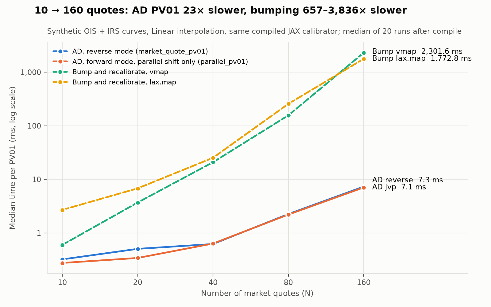

# JAX_Finance

Companion code for the [autodiff for Greeks](https://martinberridge.github.io/JAX_Finance/)
blog series: derivatives pricing written as pure JAX functions, with the risk taken by
automatic differentiation instead of by hand or by bumping. It covers three problems:

- **Black-76 options:** price and all Greeks from one reverse-mode pass.
- **SABR:** Hagan implied vols and an Adam calibration compiled as one `lax.scan`.
- **Swap PV01 through curve calibration:** sensitivity to every market quote, with the
  derivative taken through the Newton calibration by the implicit function theorem.

## Repository layout

```
├── jax_finance/   Black-76 and SABR kernels; FX market-data helpers in jax_finance.fx
├── jax_pv01/      Swap PV01: the pv01_jax kernel, its NumPy reference, data, tests, benchmarks
├── examples/      Runnable demos: black.py, sabr.py, pv01.py
├── tests/         Tests for jax_finance
├── docs/          Source of the GitHub Pages blog, plus the PV01 write-up
└── notes/         Working history: refactor plan and build prompts. Not needed for review.
```

`jax_finance` and `jax_pv01` install separately, each with its own `pyproject.toml`, because
`jax_pv01` carries a Strata-style input layer that the Black and SABR code doesn't need.
[`jax_pv01/README.md`](jax_pv01/README.md) describes its packages and tests.

## Reviewing this code

A suggested order, smallest first:

1. **[`jax_finance/black.py`](jax_finance/black.py)** with
   [`tests/test_black.py`](tests/test_black.py): the whole pattern in about 120 lines.
2. **[`jax_finance/sabr.py`](jax_finance/sabr.py)** with
   [`tests/test_sabr.py`](tests/test_sabr.py) and
   [`tests/test_regression.py`](tests/test_regression.py).
3. **[`jax_pv01/pv01_jax/risk.py`](jax_pv01/pv01_jax/risk.py)** and
   [`calibrate.py`](jax_pv01/pv01_jax/calibrate.py): AD through the calibration, with
   [`test_implicit_derivatives`](jax_pv01/tests/jax_port/test_implicit_derivatives.py) and
   [`test_bump`](jax_pv01/tests/jax_port/test_bump.py).
4. **[`jax_pv01/benchmarks/`](jax_pv01/benchmarks/)**: how the numbers below were measured.

What the tests compare against:

| Code | Independent reference |
|---|---|
| Black-76 Greeks | Closed forms written with `math.erf` |
| SABR vols | QuantLib `sabrVolatility`, captured in [`tests/golden/`](tests/golden/) |
| SABR calibration | Recovery of known parameters; `scan` against a ported Python loop |
| FX helpers | Delta and strike round trips; quoted forwards against the rate differential |
| PV01 | Hand-coded sensitivities, bump-and-recalibrate, finite differences |

The PV01 goldens are regression baselines from this code, not Strata output, and a direct
comparison with Strata hasn't been run. [`docs/pv01_jax.md`](docs/pv01_jax.md) lists the known
convention differences.

## Architecture: kernel → transform → risk

Each problem has the same three layers.

| Layer | What it is | Where |
|---|---|---|
| **Kernel** | A pure function from inputs to a price, with no derivative code in it | `black_price`, `sabr_implied_vol`, `pv_swap`, `residuals` |
| **Transform** | JAX turning that function into its derivative, batch or compiled form | `jax.grad`, `jax.jvp`, `jax.vmap`, `jax.jit`, `lax.scan`, `lax.custom_root` |
| **Risk** | The Greeks or PV01 in market units | `compute_greeks_single`, `calibrate_sabr`, `market_quote_pv01`, `parallel_pv01` |

**Black-76** ([`jax_finance/black.py`](jax_finance/black.py)). With $\omega = +1$ for a
call and $-1$ for a put,

$$V = e^{-rT}\left[\omega F N(\omega d_1) - \omega K N(\omega d_2)\right], \qquad d_{1,2} = \frac{\ln(F/K) \pm \tfrac12\sigma^2 T}{\sigma\sqrt T}.$$

`value_and_grad` gives the price with delta, vega, theta and rho in one pass, and
`grad(grad)` gives gamma. The tests check them against the closed forms to 1e-10.

**SABR** ([`jax_finance/sabr.py`](jax_finance/sabr.py)). The Hagan (2002) lognormal vol,
with $z/x(z)$ replaced by its series near the money and a "double where", so values and
gradients stay finite at $K = F$. The formula is in the module docstring.

**PV01 through calibration** ([`jax_pv01/pv01_jax`](jax_pv01/pv01_jax)). The
curves' zero rates $z$ are calibrated so that each instrument's par rate matches its
quote: $r(z, q) = \mathrm{par}(z) - q = 0$, solved by Newton. The PV01 to the quotes is

$$\frac{\partial\,\mathrm{PV}}{\partial q} = \frac{\partial\,\mathrm{PV}}{\partial z}\,\frac{dz}{dq}, \qquad \frac{dz}{dq} = -\left(\frac{\partial r}{\partial z}\right)^{-1}\frac{\partial r}{\partial q} = \left(\frac{\partial\,\mathrm{par}}{\partial z}\right)^{-1}.$$

`lax.custom_root` applies this implicit-function rule, so reverse mode never
differentiates through the Newton iterations: it costs one transposed solve with the
Jacobian Newton already uses. The minimal path is two functions in
[`pv01_jax/risk.py`](jax_pv01/pv01_jax/risk.py):

```python
from pv01_jax.risk import market_quote_pv01, pv_from_quotes

pv = pv_from_quotes(problem, swap, q)        # calibrate the curves, then price the swap
pv01 = market_quote_pv01(problem, swap, q)   # jax.grad of pv_from_quotes, in GBP per bp
```

`problem` comes from `pv01_jax.resolve.resolve_calibration_problem` (the Strata example
configuration) or `pv01_jax.synthetic.synthetic_problem` (any size).
[`examples/pv01.py`](examples/pv01.py) runs the whole sequence, and
[`docs/pv01_jax.md`](docs/pv01_jax.md) maps the modules.

## Benchmark: AD costs about one extra calibration; bumping costs 2N



Reverse-mode AD costs 1.3–1.4 calibrations, whatever the number of quotes N. Bumping
each quote up and down costs 2N recalibrations: 297 calibrations' worth at N = 160,
against 320. Both run on **the same compiled JAX pricer and calibrator**, so the gap is
the method, not the implementation. From 10 to 160 quotes, AD gets 23× slower and
bumping 657–3,836× slower.

On the real 19-quote GBP configuration with linear interpolation:

| Method | Median time |
|---|---:|
| One calibration and price (`pv_from_quotes`) | 0.51 ms |
| AD, reverse mode (`market_quote_pv01`) | 0.70 ms |
| JAX bump and recalibrate, `vmap` | 3.1 ms |
| JAX bump and recalibrate, `lax.map` | 10.5 ms |
| Legacy NumPy bump (`pv01_pricer.bump_pv01`) | 18.4 s |

The NumPy row is legacy context: a hand-written, uncompiled NumPy port of the Strata
pipeline, so its gap mixes method and implementation. It isn't the comparison the chart
makes. Timings are medians of 20 runs after compilation, on CPU (JAX 0.10.0, WSL2), and
vary between runs. The full tables are in
[`real_config.md`](jax_pv01/benchmarks/results/real_config.md) and
[`scaling.md`](jax_pv01/benchmarks/results/scaling.md).

## Roadmap

| # | Post | Status | Code |
|---|---|---|---|
| 1 | [Getting the Greeks from autodiff: why options look like neural networks](docs/_posts/2026-09-10-Get-The-Greeks-Using_Autodiff.md) | Published 2026-09-10 | Concepts behind [`jax_finance/black.py`](jax_finance/black.py) |
| 2 | Inside the autodiff engine: how ML libraries compute Greeks without ever building a Jacobian | Draft (dated 2026-09-29) | JVP and VJP: `compute_greeks_single` in [`jax_finance/black.py`](jax_finance/black.py), `jax.jvp` and `jax.grad` in [`pv01_jax/risk.py`](jax_pv01/pv01_jax/risk.py) |
| 3 | Getting the Greeks using JAX: implementation | Draft | [`jax_finance/black.py`](jax_finance/black.py) |
| 4 | SABR calibration with JAX | Draft | [`jax_finance/sabr.py`](jax_finance/sabr.py) |
| 5 | PV01 by AD through curve calibration | Write-up in [`docs/pv01_jax.md`](docs/pv01_jax.md) | [`jax_pv01/pv01_jax`](jax_pv01/pv01_jax), demo [`examples/pv01.py`](examples/pv01.py) |

## Quickstart

```bash
python3 -m venv jax_env
source jax_env/bin/activate
pip install -e ".[fx,dev]"           # jax_finance, the FX helpers (QuantLib, SciPy, Polars), pytest
pip install -e "jax_pv01[bench]"     # pv01_jax and the Strata-port layers, matplotlib

pytest                               # root suite: Black, SABR, FX and regression tests (about two minutes)
(cd jax_pv01 && python -m unittest discover -s tests -t .)
python examples/pv01.py              # PV and PV01 table for each interpolator
python examples/black.py             # Black-76 price and Greeks
python examples/sabr.py              # SABR calibration: synthetic smiles, then EURUSD
(cd jax_pv01 && python -m benchmarks.real_config)
(cd jax_pv01 && python -m benchmarks.scaling)
```

- The jax_pv01 package must be an editable install: its example CSVs are read from the
  source tree.
- `RUN_SLOW=1` adds the legacy bump-and-recalibrate comparisons to the jax_pv01 suite, which
  then takes about an hour. `benchmarks.real_config --slow` adds the slow legacy NCS bump.
- Importing `jax_finance` or `pv01_jax` turns on 64-bit floats (`jax_enable_x64`), which
  is a process-wide JAX setting.
- The first call of each compiled function includes JIT compilation, 2–20 s per
  interpolator for the PV01 functions.
